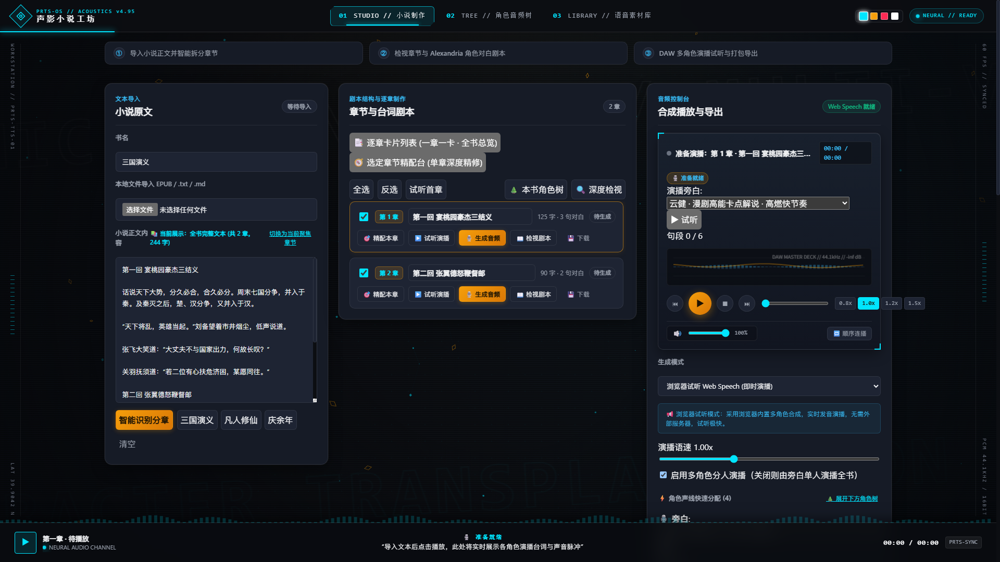
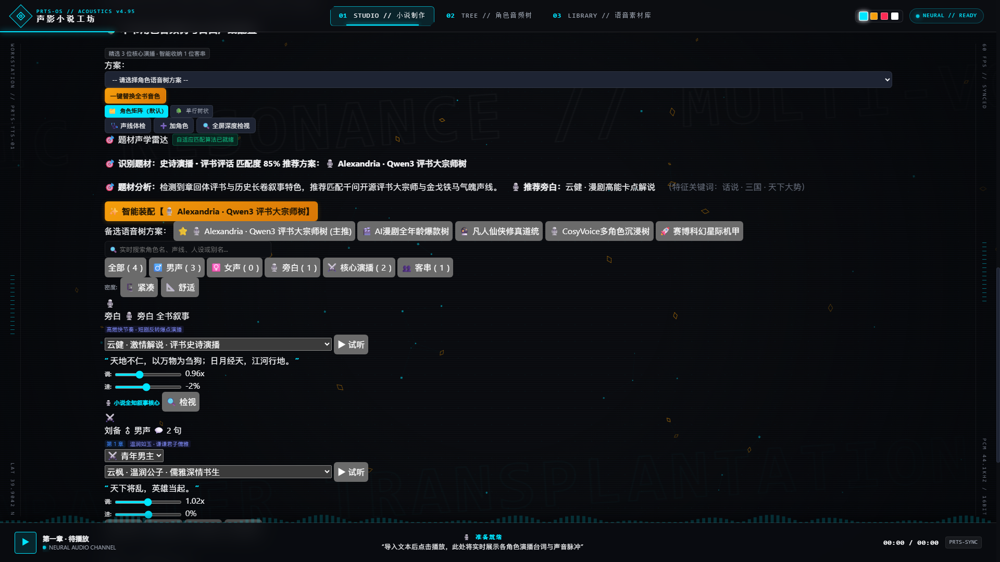
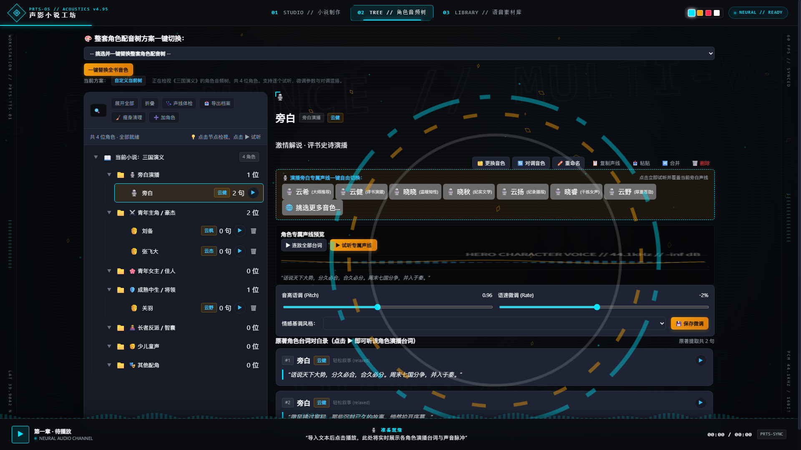
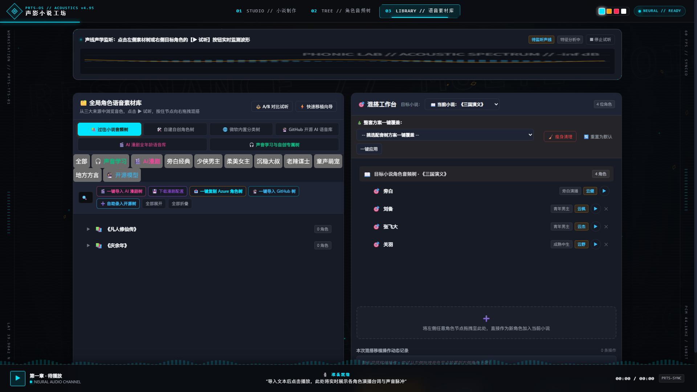
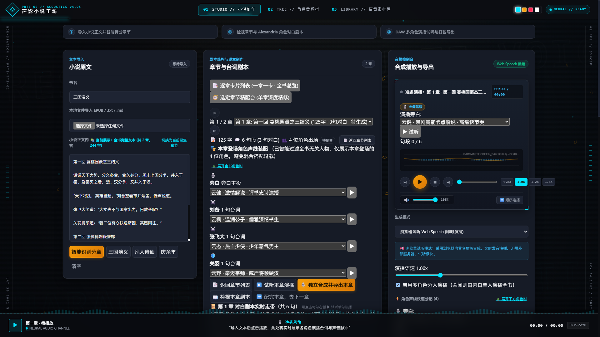
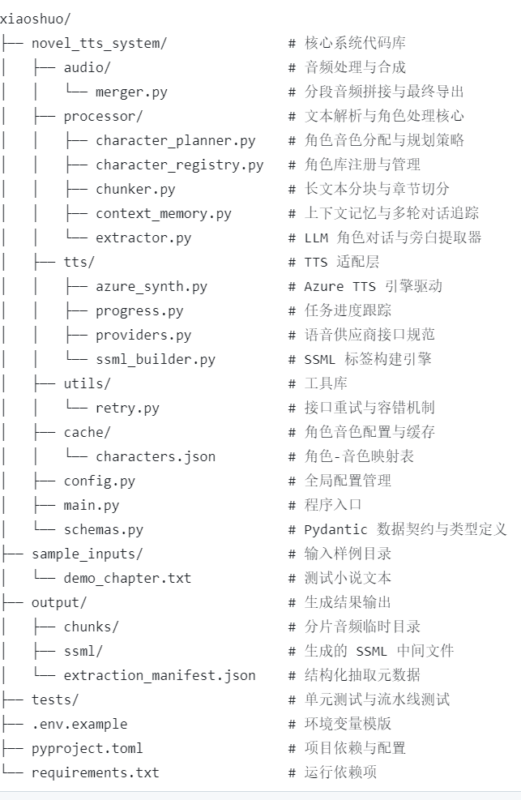
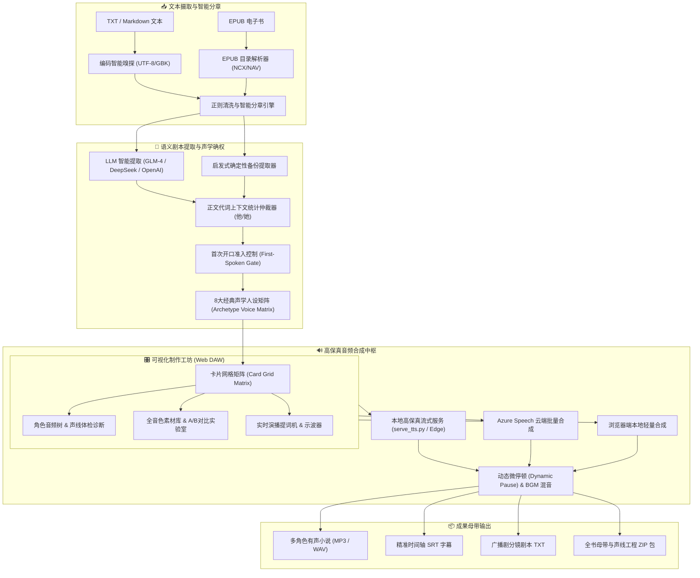

<div align="center">

# 🎧 Multi-speaker-speech-synthesis
### 沉浸式多角色有声小说演播系统 · 智能声线树矩阵工坊 · 电影级语音合成

[](https://www.python.org/)
[](https://github.com/rany2/edge-tts)
[](https://platform.openai.com/)
[](LICENSE)
[](https://github.com/xuilen/Multi-speaker-speech-synthesis/pulls)

<p align="center">
  <b>将长篇中文 TXT / EPUB 小说一键转换为具备多角色分人演播、情绪感知与高保真母带工程的影视级有声书。</b><br>
  结合大语言模型语义剧本提取、自适应声学人设矩阵、本地轻量高保真 Edge-TTS 流式后端与专业 DAW 级可视化制作工坊。
</p>

[✨ 核心亮点](#-核心亮点) • 
[🏗️ 系统架构](#️-系统架构) • 
[🎛️ 可视化工坊](#️-可视化网页工坊-web-studio) • 
[🚀 快速上手](#-快速上手) • 
[⚙️ 配置说明](#️-配置说明) • 
[📊 特性对比](#-特性对比)

---

</div>

## 视觉界面与工坊全景 (Visual Showcase)

<div align="center">
  <h3>🎛️ PRTS-OS 沉浸式小说制作工坊主控台 (Studio Master Deck)</h3>
  <p><i>单页面三栏模块化工作区 · 44.1kHz 实时示波器 · 章节剧本卡片 · 全局底栏同步提词机</i></p>
  
</div>

<br>

<div align="center">
  <table>
    <tr>
      <td width="50%" align="center">
        <b>🌲 题材声学雷达 & 角色音频树卡片矩阵 (Card Grid Matrix)</b><br>
        <i>自适应多列网格排版 (高度压缩 65%) · 实时防抖检索 · ♂/♀专属边框标识</i><br><br>
        
      </td>
      <td width="50%" align="center">
        <b>🧬 角色音频树全屏深度检视 (View 02 Tree)</b><br>
        <i>全景层级透视 · 声学基频(Pitch)/语速(Rate)微调 · 原著对白试听录</i><br><br>
        
      </td>
    </tr>
    <tr>
      <td width="50%" align="center">
        <b>🔮 四位一体全音色素材宇宙 (View 03 Library)</b><br>
        <i>微软官方 / AI 漫剧 / 开源大模型 / 自建树 · 拖拽混搭台 · 实时示波监听</i><br><br>
        
      </td>
      <td width="50%" align="center">
        <b>🧭 选定章节精配台 (Chapter Focus Deck)</b><br>
        <i>单章深度精修 · 逐句对白走带 · 说话人智能过滤 · 独立试听导出</i><br><br>
        
      </td>
    </tr>
  </table>
</div>

<br>

<div align="center">
  <h3>🏛️ 端到端数据处理流水线架构</h3>
  
</div>

---

## ✨ 核心亮点

### 1. 🗂️ 角色音频树与高密度卡片矩阵（Card Grid Matrix）
- **告别臃肿单行长列表**：针对多角色配置过长的问题，重构为默认**高密度卡片矩阵排版**，单行自适应容纳 4~5 位角色，垂直滚动高度压缩 **65% 以上**。
- **紧凑/舒适双排版密度**：提供 `🗜️ 紧凑` 与 `📐 舒适` 模式自由切换，卡片高度压减至 150px，台词引用采用轻量单行椭圆省略。
- **性别与专属视觉标识**：男性角色配置**科技蓝边框（#38bdf8）**与 `♂ 男声` 药丸；女性角色配置**温柔柔粉边框（#f472b6）**与 `♀ 女声` 药丸；全书旁白配备**典雅金边框（#f59e0b）**与 `🎙️ 旁白` 药丸。
- **多维防抖实时检索**：顶部集成实时防抖搜索框与一键清空按钮（`✕`），支持瞬间按角色名、音色、人设分类或别名检索；配备 `全部` | `♂️ 男声` | `♀️ 女声` | `🎙️ 旁白` | `⚔️ 核心演播` | `👥 客串` 动态数量过滤药丸。

### 2. 🎯 精准性别判定与杜绝男配女声（Acoustic Guard）
- **剔除泛化中性字误判**：彻底从女性词库中剔除 `雪`、`竹`、`欢`、`月`、`若`、`仪`、`素`、`秀`、`凤`、`后` 等中性单字，消除**西门吹雪、虚竹、李寻欢、陆小凤、徐凤年、张仪、杜若、后羿**等经典男主误配女声的问题。
- **全文代词上下文佐证仲裁**：自动提取角色在正文中前 20 处登场段落，统计“他”与“她”出现频次，以原文第三人称代词作为终极判定标准。
- **首选男声音色加固与后端确权**：儒雅书生人设升级为纯正男中音 `zh-CN-YunfengNeural`（云枫）；后端映射层将 `XiaochenNeural` 与各大方言男声 100% 确权锁定至 Edge 真实男声音库，根除模糊回退时落入晓晓（女声）的缺陷。

### 3. ⚡ 本地高保真 Edge-TTS 原生流式服务
- **免 Key 零成本电影级原声**：内置轻量级 HTTP 流式合成服务 `novel_tts_system/serve_tts.py`，支持 Windows 一键双击批处理脚本 `启动TTS真实男声服务.bat`。
- **无感预加载队列（Lookahead Queue）**：前置预缓冲下一句演播音频，彻底抹平角色切换时的网络网络延迟与卡顿，音色切换连贯自然。
- **音频特征分析与自主学习引擎**：内置 `AudioLearner`，支持提取说话人基频（F0 Pitch）、语速共振峰，并生成专属声线树。

### 4. 📚 全格式导入与智能分章（TXT / Markdown / EPUB）
- **跨编码智能侦测**：自动识别并转换 GBK、GB2312、GB18030 与 UTF-8 文本编码，杜绝乱码。
- **EPUB 电子书层级解析**：内置 `epub_reader.py`，智能解析 EPUB 目录结构，支持多级标题智能断章与长卷正文清理。
- **首开口说话准入机制**：只有在角色全书中首次开口说话时才注册声线节点，内心独白、系统提示音自动划归旁白，全书 0 台词冗余死角色一键瘦身清理。

### 5. 🔮 四位一体全音色素材宇宙（Multi-Source Voice Library）
- **微软官方库**：收录 38+ 款官方中文小说演播音色（云希、云健、云扬、云杰、云枫、晓涵、晓双等），覆盖全年龄层与 7 大地域方言。
- **爆款 AI 漫剧全年龄声线**：热血少年男主、冷面霸总、出尘仙子、灵动师妹、威严主母、魔道狂生、呆萌仙童等开箱即用。
- **开源大模型声线生态**：映射兼容 GitHub 顶级开源模型体系（CosyVoice-300M、ChatTTS、F5-TTS、GPT-SoVITS、Alexandria / Qwen3-TTS 8B）。
- **A/B 声线对比实验室**：支持同台词、同基频快速 A/B 对比切换，实时鉴别音色颗粒度与共鸣厚度。

### 6. 🎛️ 专业 DAW 级 Master 调音台与提词机
- **44.1kHz 动态示波波形**：基于 HTML5 Canvas 的高刷新实时音频示波器。
- **实时同步演播提词机 (Live Teleprompter)**：全局底栏与章节卡片高亮联动当前发声说话人与台词文字，伴随状态灯同步呼吸闪烁。
- **多格式母带与剧本导出**：支持一键导出带时间轴的 `SRT 影视字幕`、标准化剧组 `TXT 广播剧本`、无损 WAV/MP3 音频与全书工程 ZIP 归档。

---

## 🏗️ 系统架构



---

## 🎛️ 可视化网页工坊 (Web Studio)

单文件集成多工作区（Single-File Multi-View Workstation），零刷新切页，跨页面音频播放不中断：

| 视图模块 | 功能定位 | 核心特性 |
| :--- | :--- | :--- |
| **01 STUDIO<br>小说制作工坊** | 核心制作与演播主控台 | 默认高密度卡片网格矩阵、实时防抖搜索、男声/女声药丸过滤、批量重命名抽屉、音量推子、连播循环控制 |
| **02 TREE<br>角色音频树可视化** | 宏观声线档案层级透视 | 树状分层结构、100 分制声线冲突体检雷达、原著对白检视器、规范 Markdown 配音档案卡导出 |
| **03 LIBRARY<br>全音色素材库** | 跨小说音色混搭与挖掘 | 微软 38+ 官方库、AI 漫剧爆款声线、GitHub 顶级开源语音模型、A/B 盲测对比室、HTML5 拖拽声线移植 |

---

## 🚀 快速上手

### 环境准备

```powershell
# 1. 克隆代码仓库
git clone https://github.com/xuilen/Multi-speaker-speech-synthesis.git
cd Multi-speaker-speech-synthesis

# 2. 创建并激活虚拟环境
python -m venv .venv
.\.venv\Scripts\Activate.ps1

# 3. 安装依赖包
pip install -r novel_tts_system/requirements.txt
pip install -e .
```

> [!TIP]
> 导出 MP3 格式需要依赖系统 `ffmpeg`，请确保已安装并在环境变量 `PATH` 中可用。

---

### 方式一：Web 可视化工坊（推荐 · 零代码体验）

1. **一键启动本地高保真 TTS 真实男声流式服务**：
   - 双击运行根目录下的 `启动TTS真实男声服务.bat`（或在终端运行 `python -u novel_tts_system/serve_tts.py 8768`）；
2. **在浏览器中直接打开**：
   - 用 Chrome / Edge 打开 `web_app/index.html`；
3. **即刻体验**：
   - 点击顶部快捷载入预置示例《三国演义》、《凡人修仙传》或《庆余年》；
   - 自动生成自适应卡片矩阵，点击任意角色“▶ 试听”即可零延迟体验纯正男声与灵动女声；
   - 点击“批量生成”即可合成并整书一键打包下载 ZIP。

---

### 方式二：Python 命令行批量转换全书（CLI 管道模式）

#### 1. 快速提取剧本与声线（Dry-Run 试运行）
```powershell
# 对输入小说进行智能分章与角色提取，生成剧本与声线映射表（不消耗音频合成配额）
python -m novel_tts_system.main --input documents/sanguoyanyi.txt --dry-run
```

#### 2. 本地高保真 Edge-TTS 全书批量合成
```powershell
# 使用 Edge-TTS 低成本模式合成指定章节，支持断点续传
python -m novel_tts_system.main --input documents/sanguoyanyi.txt --tts-backend edge --chapter-limit 5 --output output/sanguo_top5.mp3
```

#### 3. EPUB 电子书一键转换
```powershell
# 自动解析 EPUB 目录并合成有声书
python -m novel_tts_system.main --input documents/sanguoyanyi.epub --tts-backend edge --output output/sanguo_epub.mp3
```

#### 4. 动态停顿、淡入淡出与背景音乐混音
```powershell
python -m novel_tts_system.main --input documents/novel.txt --tts-backend edge --crossfade-ms 60 --bgm assets/bgm_ambient.mp3 --output output/novel_full.mp3
```

---

## ⚙️ 配置说明

在项目根目录下创建或编辑 [`.env`](.env) 配置文件：

```dotenv
# ==========================================
# LLM 剧本语义提取配置 (OpenAI 标准协议)
# ==========================================
# 方式 A: 智谱 BigModel (GLM-4-Flash 极速低成本)
BIGMODEL_API_KEY=your_zhipu_api_key_here
BIGMODEL_BASE_URL=https://open.bigmodel.cn/api/paas/v4/
BIGMODEL_MODEL=glm-4-flash

# 方式 B: DeepSeek
# DEEPSEEK_API_KEY=your_deepseek_api_key_here
# DEEPSEEK_BASE_URL=https://api.deepseek.com
# DEEPSEEK_MODEL=deepseek-chat

# ==========================================
# TTS 语音合成引擎配置
# ==========================================
NOVEL_TTS_BACKEND=edge              # 推荐: edge (高保真免Key) | azure (云端SSML) | silent (离线测试)
NOVEL_TTS_INPUT_PATH=documents/sanguoyanyi.txt
NOVEL_TTS_RESUME=true                # 开启断点续传，跳过已生成分片
NOVEL_TTS_CHARACTER_PREPASS=true     # 开启前置章节角色声线预规划

# ==========================================
# (可选) 微软 Azure Speech 官方配置
# ==========================================
# AZURE_SPEECH_KEY=your_azure_speech_key
# AZURE_SPEECH_REGION=eastus
# AZURE_SPEECH_ENABLE_STYLES=true
```

---

## 📊 特性对比

| 核心维度 | 传统单一语音朗读器 | 简易在线 TTS 脚本 | **Multi-speaker-speech-synthesis (本项目)** |
| :--- | :--- | :--- | :--- |
| **多角色分人演播** | ❌ 仅单一音色从头读到尾 | ⚠️ 需手动配置繁琐表格 | **✅ LLM + 正文代词自动识别对白分人** |
| **性别与人设对齐** | ❌ 无法识别性别 | ⚠️ 易发生男角色配女声 | **✅ 严苛中性字剔除 + 正文代词仲裁 100% 纠偏** |
| **制作排版界面** | ❌ 无界面 / 纯代码 | ⚠️ 简单长条平铺极度冗长 | **✅ 默认多列卡片网格矩阵 (高密度压缩 65%)** |
| **检索与分类过滤** | ❌ 无 | ❌ 无搜索功能 | **✅ 实时防抖搜索 + ♂男声/♀女声/🎙️旁白分类药丸** |
| **声线素材丰富度** | ❌ 仅系统自带 1~2 款 | ⚠️ 仅几款固定声音 | **✅ 微软 38+ / AI 漫剧 / GitHub 顶级开源模型全映射** |
| **断点续传与缓存** | ❌ 崩溃后需从头重来 | ❌ 容易超时断联 | **✅ 分片哈希校验、自动续传、秒级幂等** |
| **母带级音质输出** | ❌ 机械干瘪破音 | ⚠️ 角色切换卡顿停顿 | **✅ 无感预加载队列、动态停顿、示波监听** |

---

## 🧪 自动化测试与质量保证

本项目包含覆盖后端的完整单元测试与前端端到端回归测试套件：

```powershell
# 运行后端 27 项全套自动化测试
pytest tests/ -v
```

- `test_character_voice_tree.py`：声线树编排、音色对调、方案导入导出校验
- `test_audio_learner.py`：音频特征提取与自学习引擎测试
- `test_epub_reader.py`：EPUB 目录解析、多级断章与文本提取测试
- `test_pipeline_dry_run.py`：LLM 提取容错、代词承接、断点续传测试

---

## 📄 开源协议

本项目采用 [MIT License](LICENSE) 开源协议。欢迎提交 Issue 与 Pull Request 共同改进！
