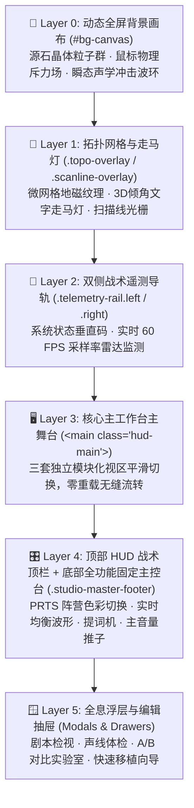

# 声影小说工坊 // PRTS-OS TACTICAL WORKSTATION

声影小说工坊是一套以《明日方舟》音律联觉与 PRTS 战术终端为视觉灵感，结合专业音频工作站（DAW）、`react-arborist` 树形组件与 `alexandria-audiobook` 剧本微调理念打造的高端 **AI 小说多角色有声书演播与素材混搭工作站**。

借鉴参考 `theater_arknights_mv(1).html` 的**分层、分页与一体化前端架构**，全面重构了早期分散加载的多 HTML 结构，实现了**单文件集成多工作区 (Single-File Multi-View Workstation)**：彻底消除传统多页面跳转导致的页面白屏重载与音频播放中断，让整个演播与混搭流程如同原生桌面 DAW 般丝滑流畅、零臃肿。

---

## 🏗️ 战术视觉分层系统 (Visual Depth Layers)

---

## 🚀 三大核心工作区（零重载模块化分页）

### 01 STUDIO // 小说制作工坊 (`sec-studio`)
- **文本导入与智能分章**：本地 `.txt`/`.md` 一键导入或正文粘贴，智能识别章节标题并拆分；预置《三国演义》、《凡人修仙传》、《庆余年》名著示例。
- **Alexandria 剧本编辑器与批量批处理工具**：
  - **整章说话人批量重命名抽屉**：一键将当前章节指定说话人（如“人物”）批量替换为指定角色（如“关羽”）。
  - **双格式专业剧本导出**：带精准时间轴的 `SRT 字幕` 与标准化剧组 `TXT 广播剧本`。
- **DAW 主控辅助通道**：
  - **总输出音量推子与静音**：`0% ~ 100%` 实时音量调节与一键静音（🔊/🔇）。
  - **三种演播连播模式**：`🔁 顺序连播`（全书连贯播放）、`🔂 单章循环`（精修台词语气）、`⏹ 播完即止`。
  - **实时演播提词机 (Live Teleprompter)**：章节卡片与全局底部主控台实时同步显示正在发声的说话人与台词正文，伴随青色呼吸灯同步闪烁。
- **三大生成与导出模式**：
  1. **浏览器试听 Web Speech**：零延迟本地客户端多角色分人演播。
  2. **浏览器内录导出 WAV**：生成标准 PCM RIFF WAV 格式音频，支持单章或批量生成。
  3. **在线接口模式**：支持配置外部自定义 TTS API 批量导出高品质音频。
- **整书打包导出**：自动打包已生成音频、正文剧本及配音树 JSON 元数据为统一 ZIP 压缩包。

### 02 TREE // 角色音频树可视化 (`sec-tree`)
- **借鉴 `react-arborist` 的层级树结构**：
  - **根节点**：当前小说（显示书名、总角色数、总台词量统计）。
  - **分组分支**：按人设自动归类（🎙️ 旁白演播、⚔️ 青年男主、🌸 青年女主、🛡️ 成熟中生、🦹 长者反派、🧒 少儿童声、🏮 方言特色）。
  - **叶子节点**：小说各登场角色，显示人设徽章、绑定音色、原著台词句数，并配备即刻试听按钮（▶）。
- **声线健康体检系统 (Voice Health Diagnostic)**：
  - **100 分制雷达评分**：全书声线健康度多维度启发式体检。
  - **声线重叠冲突侦测**：自动检测多个核心角色是否撞声（如误将同一音色赋予两位主角），标记冲突风险并扣分。
  - **人设/性别匹配度校准**：自动比对角色分组与微软音色性别、年龄段设定。
  - **✨ 一键智能优化分配**：算法自动从微软音色池中为撞声角色重新均衡分配专属声线。
- **配音档案 Markdown 导出 (Casting Card Export)**：一键导出包含书名、总台词量、人设归属、音高语速与原著金句的规范 Markdown 配音档案。
- **借鉴 `alexandria-audiobook` 的角色检视器**：
  - 音高语调（Pitch 0.6~1.4）、语速微调（Rate -30%~+30%）、基调风格。
  - 角色专属声线预览画布与代表句试听。
  - **原著台词对白录**：自动从小说文本中检索该角色的所有实际对白，支持逐句试听该角色演播自身原著台词。

### 03 LIBRARY // 全局角色语音素材库 (`sec-library`)
- **全息声学监听视听舱 (Acoustic Phonic Monitor Deck)**：
  - 顶部配备全景实时示波波形，点击任意音色或角色节点即可进行高频共振监听。
- **四大素材来源（左栏切换）**：
  1. 📚 **过往小说音频树 (Past Novels Archive)**：收录过往上传的所有小说角色音频树，支持跨小说提取人物声线。
  2. 🛠️ **自建自创角色树 (Custom Designed Trees)**：预置各大经典方案，配备 `📥 一键复制 Azure 角色树` 与 `🔮 一键导入 GitHub 树`，无需试听一键直接填满 22 个角色的全套配音档案！
  3. 🌐 **微软语音官方库 (Azure/Edge 38+ Neural Catalog)**：完整收录 38+ 款官方中文小说演播音色，覆盖各大主要年龄层、演播原型与 7 大地域方言。
  4. 🔮 **GitHub 开源 AI 语音大模型库 (Open-Source Speech Models)**：
     - **Alexandria / Qwen3-TTS 8B** (Finrandojin/alexandria-audiobook)：评书大宗师、剑宗少侠、望舒仙子、九幽魔皇、灵狐小师妹；
     - **CosyVoice-300M** (FunAudioLLM/CosyVoice)：自然文学演播、热血国漫主角、天狐御姐、扫地神僧；
     - **ChatTTS** (2noise/ChatTTS)：市井茶馆说书、随性青年、轻笑灵动少女；
     - **F5-TTS** (SWivid/F5-TTS)：赛博特勤、星际编年史宏大叙事、暗夜宿敌；
     - **GPT-SoVITS** (RVC-Boss/GPT-SoVITS)：青莲剑仙、软萌仙山道童；
     - **Fish-Speech** (fishaudio/fish-speech)：电台超清高保真演播。
- **声学性别与共鸣下潜校准 (Acoustic Formant & Timbre Calibration)**：
  - 彻底解决浏览器/Windows 本地语音库单一女声导致的“所有角色听起来都是女声”的严重缺陷。
  - 智能嗅探系统合成器音色性别，演播男声时动态实施共振峰与音高下潜（~1.5个八度下压至 100-130Hz 男低音/男中音共鸣带），使沉稳男主、沧桑老者与反派呈现雄浑阳刚的真实质感。
- **题材风格快速筛选胶囊 (Genre Pills)**：
  - 快捷切换 `全部` / `旁白经典` / `少侠男主` / `柔美女主` / `成熟大叔` / `老辣谋士` / `童声萌宠` / `地方方言` / `开源AI`，四大素材源同步联动过滤。
- **A/B 声线对比试听实验室 (A/B Comparison Lab)**：
  - 支持任选两款声线在相同的测试台词下进行同句、同调对比试听。
  - 预置哲理沉思、热血豪迈、温情低语、惊悚悬疑等 4 组经典台词模版，并支持自由调节各自 Pitch，快速比对基频厚度与发音细节。
- **跨小说混搭与拖拽移植工作台（右栏）**：
  - **HTML5 拖拽声线移植 (Drag and Drop)**：用户按住左侧任意素材节点，直接拖拽至右侧目标小说人物行上，即可实现声线、语调与情感风格的直接移植覆盖！
  - **拖拽新增角色**：拖拽任意素材节点至底部的“➕ 新增角色”放置区，即可将该外来角色直接加入当前小说剧本中！
  - **操作记录日志**：动态记录每次混搭移植的来源与去向。

---

## 🎨 视觉创新与高级质感

1. **零白屏无缝切页 (Zero-Reload Audio Continuity)**：
   - 切换 01/02/03 分页时无需刷新浏览器，音频播放永不中断；
   - 底部 Master 走带控制栏与实时提词器常驻显示，跨页面掌控演播进度。
2. **阵营色彩战术调色板**：
   - 罗德岛青蓝 (`Cyan`)
   - 源石曜金 (`Amber`)
   - 猩红剧场 (`Crimson`)
   - 极简黑白工业 (`Monochrome`)
3. **扎实平稳的操作台面**：
   - 所有工作台、面板、按钮与滑块均处于平整扎实的交互模式，鼠标滑过不晃动、不偏转；
   - 动感波动力场与粒子网络保留在背景与示波器中，兼具冲击力与操作舒适性。

---

## 🚀 快速使用指南

1. 双击直接在浏览器中打开 `web_app/index.html`。
2. 在 **01 STUDIO** 导入文本或选择示例，拆分章节后即可点击播放。
3. 点击顶部导航栏 **02 TREE** 查看角色音频树，点击“🩺 声线体检”排查撞声，或“✨ 一键优化”。
4. 点击顶部导航栏 **03 LIBRARY** 打开素材库，将其他名著角色的声线直接拖拽到目标小说角色上完成移植，或进入“⚖️ A/B 对比实验室”对比音质。
5. 所有修改在三大视区实时同步生效！
